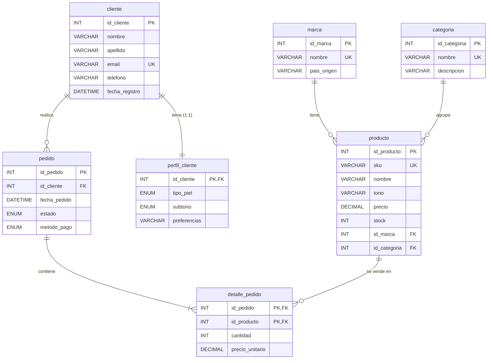

# Tienda de maquillaje: caso de estudio, entidades, normalización y modelo lógico

## Fase I. Caso de estudio y requerimientos

**Glow Studio** es una tienda pequeña de maquillaje que vende labiales, bases, productos para ojos, rubores y accesorios. Hasta ahora llevaba el inventario y las ventas en una libreta y en mensajes de chat, lo que provocaba errores: productos que se vendían sin existencia, precios que cambiaban sin dejar registro de lo cobrado antes y clientas repetidas con datos distintos.

La dueña necesita una base de datos en la que cada producto pertenezca a una marca y a una categoría, y en la que cada clienta tenga un perfil de piel (tipo de piel y subtono) para recomendarle tonos adecuados. Cada clienta puede hacer varios pedidos, y cada pedido puede incluir varios productos; a su vez, un mismo producto aparece en muchos pedidos. Al vender, se guarda el precio del momento para que un cambio de precio posterior no altere el historial.

### Entidades (7)
`marca`, `categoria`, `producto`, `cliente`, `perfil_cliente`, `pedido`, `detalle_pedido`.

### Reglas de negocio
| Regla | Tipo |
|---|---|
| Cada clienta tiene un único perfil de piel y cada perfil pertenece a una sola clienta. | **1:1** (`cliente` – `perfil_cliente`) |
| Una marca tiene muchos productos; un producto es de una sola marca. | **1:N** (`marca` – `producto`) |
| Una categoría agrupa muchos productos; un producto está en una sola categoría. | **1:N** (`categoria` – `producto`) |
| Una clienta puede hacer muchos pedidos; un pedido es de una sola clienta. | **1:N** (`cliente` – `pedido`) |
| Un pedido incluye muchos productos y un producto puede estar en muchos pedidos. | **N:M** (`pedido` – `producto`, resuelta con `detalle_pedido`) |
| El correo de la clienta y el SKU del producto no se pueden repetir. | UNIQUE |
| El precio debe ser mayor a 0 y la cantidad vendida mayor a 0. | CHECK |
| No se puede eliminar un producto, marca, categoría o clienta con historial. | ON DELETE RESTRICT |
| Al eliminar un pedido se eliminan sus renglones; al eliminar una clienta su perfil. | ON DELETE CASCADE |

### Transacciones y consultas frecuentes
1. Consultar el catálogo con marca, categoría, precio y existencias (JOIN de 3 tablas), con búsqueda por nombre, SKU o marca.
2. Registrar, editar y dar de baja productos (CRUD desde la aplicación web).
3. Registrar un pedido con varios productos (INSERT en `pedido` y `detalle_pedido`).
4. Consultar el total de cada pedido (`v_pedido_resumen`) y su detalle renglón por renglón.
5. Listar clientas con su perfil de piel para recomendar productos.
6. Detectar productos con poco stock (menos de 20 piezas).

## Fase II. Entidades, atributos y llaves

Entidades en singular y atributos en `snake_case`. **PK** = llave primaria, **FK** = llave foránea.

| Entidad | Atributos |
|---|---|
| `marca` | **id_marca (PK)**, nombre, pais_origen |
| `categoria` | **id_categoria (PK)**, nombre, descripcion |
| `producto` | **id_producto (PK)**, sku, nombre, tono, precio, stock, id_marca (FK), id_categoria (FK) |
| `cliente` | **id_cliente (PK)**, nombre, apellido, email, telefono, fecha_registro |
| `perfil_cliente` | **id_cliente (PK, FK)**, tipo_piel, subtono, preferencias |
| `pedido` | **id_pedido (PK)**, id_cliente (FK), fecha_pedido, estado, metodo_pago |
| `detalle_pedido` | **id_pedido (PK, FK)**, **id_producto (PK, FK)**, cantidad, precio_unitario |

## Fase III. Normalización

**Punto de partida (sin normalizar).** Una sola tabla `venta` con: id_venta, fecha, cliente_nombre, cliente_email, cliente_telefono, tipo_piel, subtono, *productos* (lista: "Labial Pioneer, Base 230"), *cantidades*, *precios*, marca, pais_marca, categoria, metodo_pago, estado, total.

**1FN (atomicidad).**
- Los grupos repetidos (productos, cantidades, precios en una celda) pasan a un renglón por producto vendido. Clave: (id_venta, id_producto).
- El nombre completo se separa en `nombre` y `apellido`.

**2FN (dependencias parciales).** Con clave compuesta (id_venta, id_producto):
- Nombre del producto, tono, precio actual, marca y categoría dependen solo de `id_producto` → tabla `producto`.
- Fecha, clienta, estado y método de pago dependen solo de `id_venta` → tabla `pedido`.
- Solo `cantidad` y `precio_unitario` dependen de la clave completa → `detalle_pedido`.

**3FN (dependencias transitivas).**
- Datos de la clienta (nombre, correo, teléfono) dependen de `id_cliente`, no del pedido → `cliente`.
- `tipo_piel` y `subtono` describen a la clienta → `perfil_cliente` (1:1).
- `pais_origen` depende de la marca → `marca`; descripción de categoría → `categoria`.
- `total` es un dato derivado (suma de cantidad × precio_unitario), así que no se guarda: se calcula en la vista `v_pedido_resumen`.

**Resultado:** 7 tablas sin redundancia, cada atributo no clave depende de la clave, de toda la clave y nada más que de la clave.

## Fase IV. Diagrama relacional

Pega este código en https://mermaid.live para obtener la imagen del reporte (PNG o SVG).

**Cardinalidades:** cliente–perfil_cliente 1:1 · marca–producto 1:N · categoria–producto 1:N · cliente–pedido 1:N · pedido–producto N:M (vía detalle_pedido).
